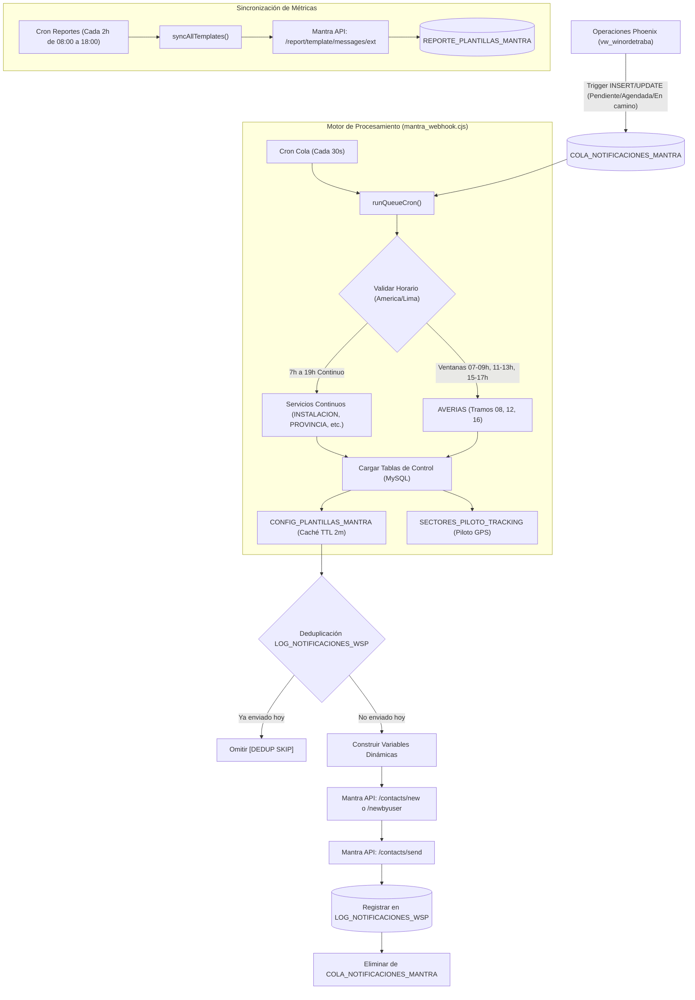

# 📲 API Mantra - Automatización de Notificaciones WhatsApp (WIN Telecom)

Módulo integral y autónomo para la sincronización de contactos, automatización de eventos y envío programado de plantillas de WhatsApp a través de la API oficial de **Mantra Chat**, integrado con la base de datos operativa Phoenix (`vw_winordetraba`).

---

## 🏗️ Arquitectura y Flujo de Operación



---

## 📂 Estructura del Proyecto

El código está organizado de manera limpia y modular para facilitar mantenimiento y auditorías:

```text
API_Mantra/
│
├── mantra_webhook.cjs             # Servidor Express, Webhook HTTP y programación de Crons
├── mantra_service.cjs             # Core de negocio, conexión MySQL (Pool) y API de Mantra
├── mantra_cron.cjs                # Script utilitario para ejecución por lotes manual
├── sync_all_template_reports.cjs  # Sincronizador de estados de mensajes y respuestas desde Mantra
├── package.json                   # Dependencias y scripts de auditoría
├── .env                           # Variables de entorno de conexión
├── .gitignore                     # Protección de archivos sensibles, zips y PII
│
├── docs/                          # Documentación oficial y manuales técnicos
│   ├── Documentacion_Mantra_API_unificada.pdf
│   ├── mantra_docs.txt
│   └── Pront.txt
│
├── data/historical/               # Resguardo histórico de datos fuera de Git
│
├── deploy/                        # Paquetes de despliegue (.zip)
│
└── scripts/
    ├── audit/                     # Herramientas de auditoría de envíos, tramos y base de datos
    │   ├── deep_audit.cjs         # Auditoría general histórica de duplicados y tramos
    │   ├── audit_today.cjs        # Auditoría de órdenes y estados notificados hoy
    │   └── ...
    ├── database/                  # Creación de esquemas, vistas, índices y triggers
    │   ├── setup_production_db.cjs
    │   ├── setup_db_dedup_constraint.cjs
    │   └── ...
    ├── contingency/               # Scripts de remediación y fe de erratas
    │   ├── send_fe_de_erratas.cjs
    │   └── ...
    └── tests/                     # Pruebas de integración y homologación de plantillas
        ├── test_all_templates.cjs
        └── ...
```

---

## ⚙️ Configuración Dinámica en Base de Datos

A diferencia de versiones anteriores con configuraciones fijas, **el sistema opera 100% controlado desde base de datos**.

### 1. `CONFIG_PLANTILLAS_MANTRA`
Controla qué plantillas, credenciales y mapeos de campos se usan según el servicio:

| Columna | Descripción |
| :--- | :--- |
| **`tipo_servicio`** | Coincide 1:1 con `TipoServicio.Tipo` (`AVERIAS`, `INSTALACION`, `PROVINCIA`, `AVERIAS PRV`, etc.). |
| **`tipo_plantilla`** | `TRACKING` (con link de seguimiento GPS), `DEFAULT` (sin tracking) o `REPROGRAMACION`. |
| **`group_id`** | Identificador del grupo en Mantra Chat. |
| **`api_key`** | Llave de autenticación para la API de Mantra. |
| **`template_id`** | Identificador de la plantilla en Mantra. |
| **`custom_1_campo` ... `custom_10_campo`** | Asignación de variables (`TICKET`, `FECHA`, `HORARIO`, `DIRECCION`, `LINK`, `PLAN`, `NOMBRE`, `TOKEN`, etc.). |
| **`activo`** | `1` para procesar el servicio, `0` para deshabilitarlo completamente sin tocar código. |

### 2. `SECTORES_PILOTO_TRACKING`
Define los sectores operativos donde se activa la plantilla `TRACKING` con geolocalización del técnico:
* Si el sector de la orden está activo (`activo = 1`), despacha la plantilla `TRACKING`.
* Si no está en piloto, conmuta automáticamente a la plantilla `DEFAULT`.

---

## ⏰ Reglas de Negocio y Horarios de Despacho

La evaluación temporal se realiza estrictamente en zona horaria de Perú (`America/Lima`):

1. **Servicio AVERIAS:**
   - **Tramo Mañana (08:00 - 12:00):** Se envía en la ventana de **07:00 a 09:00**.
   - **Tramo Tarde (12:00 - 16:00):** Se envía en la ventana de **11:00 a 13:00**.
   - **Tramo Noche (16:00 - 20:00):** Se envía en la ventana de **15:00 a 17:00**.
   - *Fuera de esas ventanas, las órdenes de averías no se disparan.*

2. **Servicios Continuos (INSTALACION, PROVINCIA, AVERIAS PRV y demás servicios activos):**
   - Se despachan de manera inmediata y continua de **07:00 a 19:00**, sin restricción de ventanas por tramos.

3. **Reprogramaciones:**
   - Detecta cambios en la tabla `reprogramaciones` y notifica con la fecha y turno solicitados por el cliente.

4. **Asignación Automática de Asesor:**
   - En instalaciones de Lima y Provincia, se utiliza el endpoint `/contacts/newbyuser` para enrutar la conversación al asesor correspondiente.

---

## 🛡️ Deduplicación y Protección contra Reenvíos

Para garantizar que ningún cliente reciba mensajes duplicados:
1. **Filtro SQL Pre-envío:** Antes de invocar a Mantra, consulta `LOG_NOTIFICACIONES_WSP` asegurando que ni el `OrdenId` ni el `CodiSegui` (Ticket) tengan un envío exitoso hoy (`DATE(fecha_envio) = CURDATE()`).
2. **Índice Único en Cola:** La tabla `COLA_NOTIFICACIONES_MANTRA` cuenta con restricción `UNIQUE (ordenId)` para evitar que la misma orden se encole más de una vez.
3. **Manejo de Triggers con INSERT IGNORE:** Los triggers en `vw_winordetraba` usan `INSERT IGNORE` para absorber eventos concurrentes sin generar bloqueos en el motor de base de datos.

---

## 📊 Sincronización de Métricas y Reportería

El script [sync_all_template_reports.cjs](file:///c:/Users/tonny/OneDrive%20-%20WI-NET%20TELECOM/Escritorio/API_Mantra/sync_all_template_reports.cjs) corre cada 2 horas (de 08:00 a 18:00) y consolida en `REPORTE_PLANTILLAS_MANTRA`:
* Estado de entrega en WhatsApp: `sent`, `delivered`, `read`, `failed`.
* Agente o asesor asignado en Mantra.
* Clics y respuestas de botones rápidos (`respuesta_boton`, `fecha_respuesta_boton`).
* Código de pedido / ticket asociado para cruce con PowerBI.

---

## 🚀 Comandos de Ejecución y Auditoría

```bash
# Iniciar servidor Webhook y Crons productivos (Azure App Service)
npm start

# Ejecutar auditoría rápida del día actual
npm run audit:today

# Ejecutar auditoría profunda de tramos, duplicados y reprogramaciones
npm run audit:deep

# Ejecutar manualmente escaneo batch
npm run cron
```
